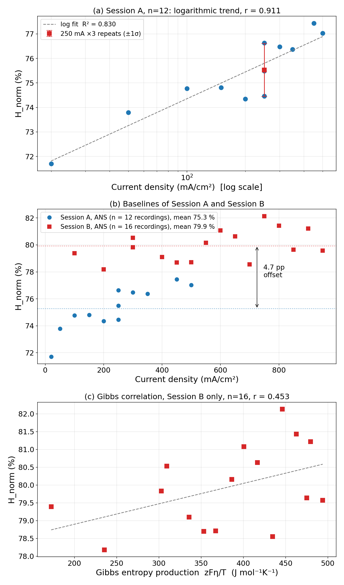
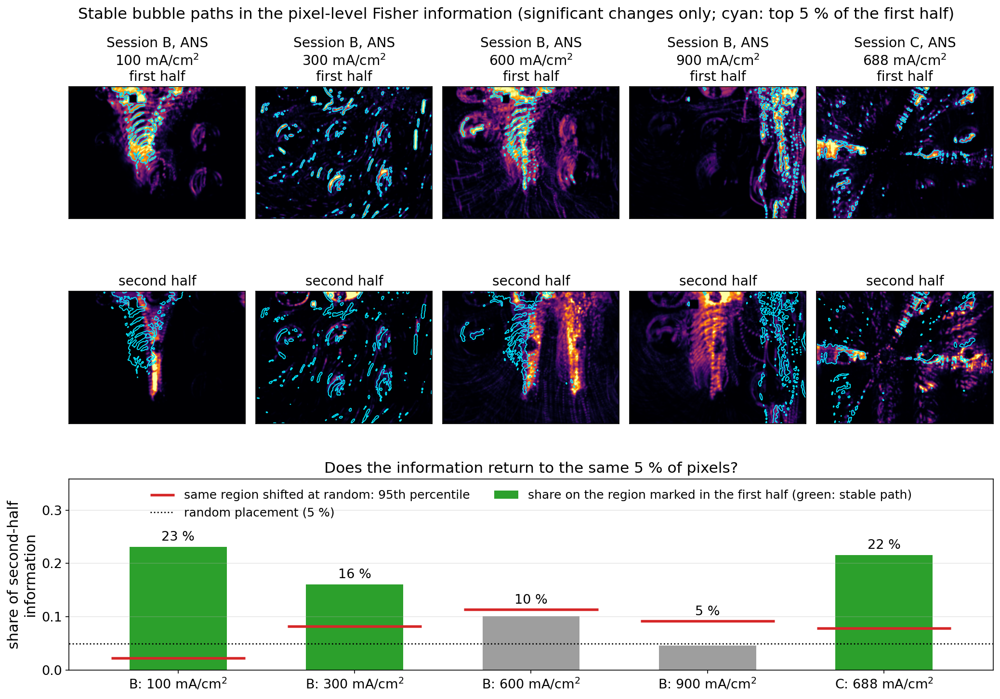
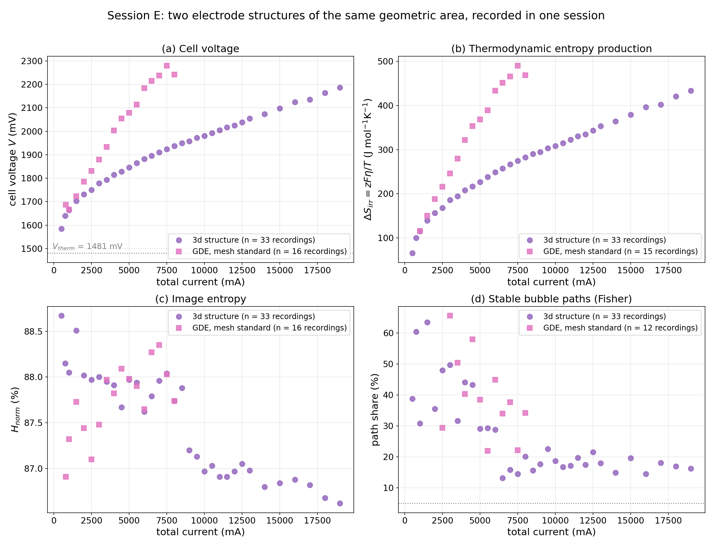
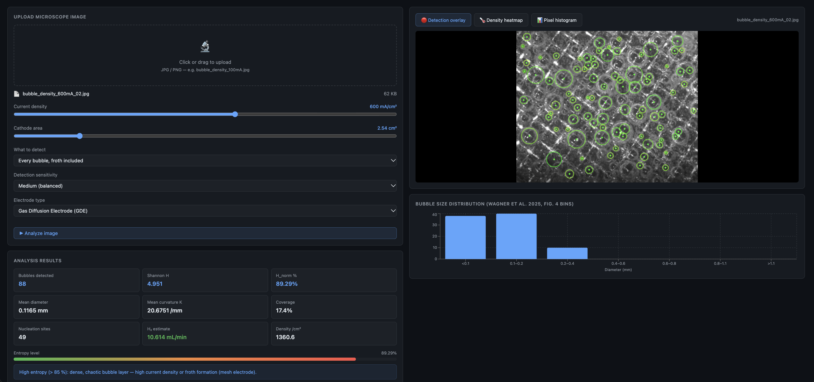
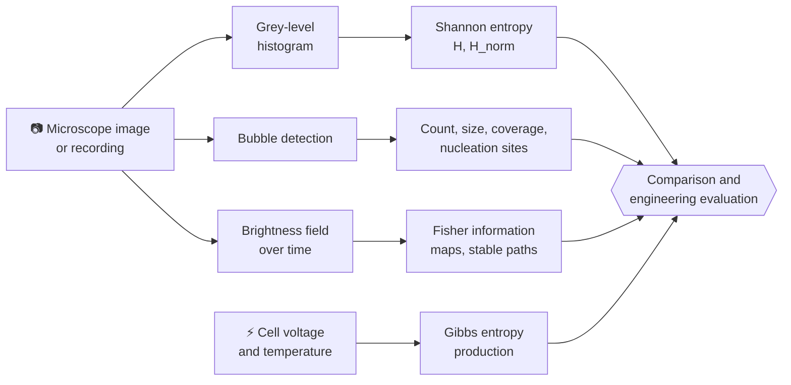
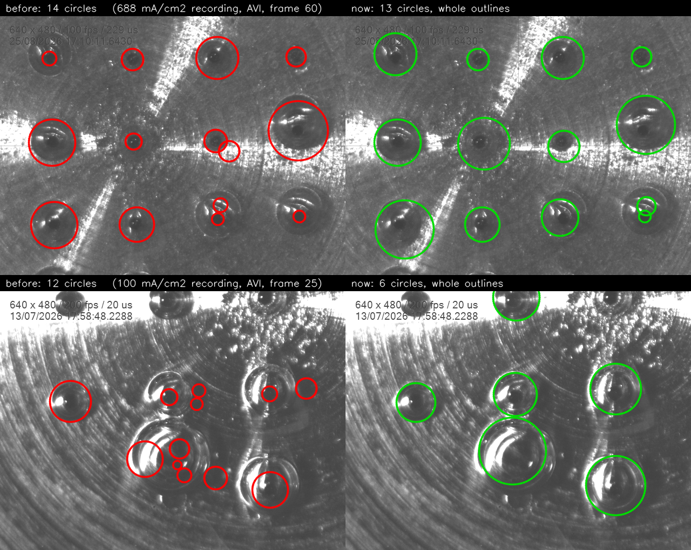

<div align="center">

# 🫧 Hydrogen Bubble Analysis System

### An AI-Based Entropy-Information Approach for Hydrogen Bubble Analysis in Alkaline Water Electrolysis

*Turning a microscope camera into a measuring instrument for electrolysers,
using Shannon entropy, Fisher information and computer vision.*

<br>

[](https://hydrogen-bubble-analysis.onrender.com/)
&nbsp;
[](#-quick-start)

<br>


<br>


<sub>Real recording from the Fuel Cell Laboratory: hydrogen bubbles on the cathode at 100 mA/cm², 200 fps, shown slowed down.</sub>

<br><br>

**Individual Project · Information Technology (M.Eng.) · Frankfurt University of Applied Sciences**
<br>
Author: **Manoj Hanumanthu** · Supervisor: **Prof. Dr. Enno Wagner** · Fuel Cell Laboratory · 2026

</div>

---

## 📑 Contents

- [The idea in one minute](#-the-idea-in-one-minute)
- [Key results](#-key-results)
- [What the application does](#-what-the-application-does)
- [How it works](#-how-it-works)
- [Quick start](#-quick-start)
- [Run with Docker](#-run-with-docker)
- [Reproduce the report](#-reproduce-the-report)
- [API reference](#-api-reference)
- [Project structure](#-project-structure)
- [Data](#-data)
- [Limitations](#-limitations)
- [Troubleshooting](#-troubleshooting)
- [References](#-references)
- [Author](#-author)

---

## 💡 The idea in one minute

An alkaline electrolyser loses energy as **overvoltage**: charge transfer, ohmic resistance, and the limits of heat and mass transport. The **gas bubbles** on the electrode belong to the last two: they cover the surface and push the electrolyte away.

**Wagner, Tennert, Probsthain and Mishra (2025)** showed that the **Shannon entropy of a bubble image** follows the **thermodynamic entropy production** of the cell. If that holds, a simple camera becomes a low-cost, non-invasive diagnostic instrument.

This project turns that idea into working software and tests it on the laboratory's own data:

| | |
|---|---|
| 🧠 **From one image to recordings** | The entropy method is applied to **film sequences** instead of single pictures, which is new. |
| 🔬 **Three independent views** | Every picture is described by **Shannon entropy**, **Fisher information** and the **bubbles themselves**. |
| ⚡ **Linked to physics** | The image measures are compared with the **Gibbs entropy production** computed from cell voltage and temperature. |
| ✅ **Reproducible** | Every figure in the report is regenerated by script, and every quoted number is checked automatically. |

---

## 📊 Key results

> 119 recordings · 6 measurement sessions · ANS electrode, mesh GDE and a 3D electrode structure

<table>
<tr>
<td width="50%" valign="top">

### 1️⃣ Entropy follows the current density

The normalised image entropy rises with the **logarithm of the current density**, the relationship proposed by Wagner, Tennert et al.

| Measure | Value |
|---|---|
| Pearson correlation | **r = 0.911** |
| Explained variance | **R² = 0.83** |
| Trend vs. repeat scatter | **≈ 5 : 1** |

<sub>Session A, ANS electrode, 12 recordings, 20–500 mA/cm²</sub>

</td>
<td width="50%" valign="top">



</td>
</tr>
<tr>
<td width="50%" valign="top">

### 2️⃣ Bubbles follow stable paths

The pixel-level **Fisher information** shows *where* the information is. The top 5 % of pixels of the first half of a recording keep collecting information in the second half:

| Current density | Path share | Random |
|---|---|---|
| 100 mA/cm² | **23 %** | 5 % |
| 300 mA/cm² | 16 % | 5 % |
| 600 mA/cm² | 10 % | 5 % |
| 900 mA/cm² | 5 % | 5 % |

Between 300 and 600 mA/cm² the paths break up. Checked against shifted regions and a motionless noise copy of every recording.

</td>
<td width="50%" valign="top">



</td>
</tr>
<tr>
<td width="50%" valign="top">

### 3️⃣ Engineering view: which electrode is more efficient?

A 3D electrode structure and the standard mesh GDE of the **same area**, recorded in one session:

| Measure | Value |
|---|---|
| Lower cell voltage, 3D structure | **up to 356 mV** |
| Common currents with lower voltage | **15 / 15** |
| Energy saved at 8000 mA | **≈ 8.1 kWh per kg H₂** |
| Camera measures that separate them | **2 of 4** |

The voltage ranks efficiency; the camera shows *how* the gas release differs: a diagnosis next to the polarisation curve.

</td>
<td width="50%" valign="top">



</td>
</tr>
</table>

> [!NOTE]
> **Honest limits.** Entropy baselines differ by up to 12 percentage points between sessions, so values are compared **within** a session, never across. In Sessions D and F the entropy stays flat within 1.1 pp, and on the 3D structure of Session E it falls with the current. The entropy carries the signature of the electrode and the imaging conditions, not only of the operating point.

---

## 🖥️ What the application does

<div align="center">

<br>
<sub>Tab 1, Image Analyzer: detection overlay, size distribution, entropy, coverage and H₂ estimate for one microscope image.</sub>
</div>

<br>

| Tab | Input | What you get |
|---|---|---|
| 🔬 **1 · Image Analyzer** | one microscope image | bubble detection overlay, Shannon entropy H and H<sub>norm</sub>, bubble count, mean diameter, curvature, coverage, nucleation sites, size distribution, density heat map, H₂ estimate (Faraday), Excel export |
| 📷 **2 · Camera / Video** | live camera (incl. USB lab cameras) | live detection overlay, frame log of entropy and bubble statistics, capture on demand |
| 🎬 **3 · Video Analyzer** | recording (MP4 / AVI) | background subtraction, bubble tracking, per-interval table of entropy and bubble statistics, frames as ZIP |
| 📊 **4 · Histogram / Fisher** | one image or frame | grey-level histogram, entropy and spatial Fisher information maps (no detector involved), Excel export |

---

## 🧩 How it works



<details>
<summary><b>📐 The equations behind it</b></summary>

<br>

| Quantity | Formula | Meaning |
|---|---|---|
| Shannon entropy | H = −Σ pᵢ ln pᵢ | spread of the grey-level histogram (256 levels) |
| Normalised entropy | H<sub>norm</sub> = H / ln 256 | 0 = one grey level, 1 = all levels equally likely |
| Overvoltage | η = V − V<sub>th</sub>, V<sub>th</sub> = 1.481 V | voltage above the thermoneutral voltage |
| Entropy production | ΔS<sub>irr</sub> = z F η / T | irreversible entropy per mole of H₂ |
| Hydrogen flow (Faraday) | ṅ = J·A / (z F) | molar H₂ production from the current |
| Bubble curvature | K = 1 / r | micro-region model |

Calibration: **0.0064 mm/pixel** · cathode area **2.54 cm²** · z = 2 · F = 96 485 C/mol.
All constants live in one place: [`backend/constants.py`](backend/constants.py).

</details>

<details>
<summary><b>🔍 Bubble detection (rim-coverage detector)</b></summary>

<br>

A circle is accepted only if a **bubble rim is visible all the way round**:

1. The picture is masked (coloured overlay text, letterbox borders, player bars) and normalised to a fixed height.
2. **Ring and dark-disc matched filters** find candidate circles from 1.2 % to 20 % of the picture height.
3. Every candidate is tested in polar coordinates at **48 angles**: rim coverage, spread, a four-fold symmetry test (rejects mesh openings) and contrast against the local noise.
4. A nesting rule removes circles inside circles; very large circles need confirmation by a second detector.

<div align="center">

<br>
<sub>Before and after the detector rewrite. On a screen capture: 215 circles → 4 bubbles, one on each.</sub>
</div>

Three sensitivities (Low / Medium / High) and two modes ("main bubbles" and "every bubble, froth included") are available in the app.

</details>

<details>
<summary><b>🎞️ Recording analysis</b></summary>

<br>

In a recording the electrode is static and the bubbles move. The **per-pixel median** over all frames reconstructs the bare electrode, because bubbles cover a given pixel in only a minority of frames. Subtracting it removes scratches and electrode texture in one step; the remainder is thresholded, cleaned and split into bubbles, which are tracked over time.

</details>

<details>
<summary><b>🧱 Architecture</b></summary>

<br>

| Layer | Technology |
|---|---|
| Backend | Python, FastAPI, Uvicorn |
| Image processing | OpenCV, scikit-image, NumPy, SciPy |
| Data and export | pandas, openpyxl, matplotlib |
| Frontend | React 18, Vite 5, Recharts, SheetJS (xlsx), axios |
| Deployment | Docker (Node build stage + python:3.12-slim), Render |

The frontend calls the API with **relative paths** (`/analyze`, …). In development, Vite forwards them to port 8000; in the cloud, FastAPI serves the built frontend and the API from **one address**.

</details>

---

## 🚀 Quick start

### Option A: just open it

👉 **https://hydrogen-bubble-analysis.onrender.com/**

> [!TIP]
> The free Render plan sleeps after 15 minutes without visitors. The first visit can take **30–60 seconds** while it wakes up. Single images are quick; for long, high-resolution videos run the project locally (the free server has 512 MB of memory).

### Option B: run it on your computer

**Requirements:** [Git](https://git-scm.com) · [Python 3.11 or 3.12](https://www.python.org/downloads/) · [Node.js 18+](https://nodejs.org) (20 LTS recommended)

**1. Clone**

```bash
git clone https://github.com/Hanumanthumanoj01/Hydrogen-Bubble-Analysis-System.git
cd Hydrogen-Bubble-Analysis-System
```

**2. Backend** (terminal 1)

<table>
<tr><th>macOS / Linux</th><th>Windows (PowerShell)</th></tr>
<tr>
<td>

```bash
cd backend
python3 -m venv venv
source venv/bin/activate
pip install -r requirements.txt
uvicorn main:app --port 8000
```

</td>
<td>

```powershell
cd backend
python -m venv venv
venv\Scripts\activate
pip install -r requirements.txt
uvicorn main:app --port 8000
```

</td>
</tr>
</table>

Check: http://localhost:8000/health returns `{"status":"healthy"}`, and http://localhost:8000/docs shows the interactive API.

**3. Frontend** (terminal 2)

```bash
cd frontend
npm install
npm run dev
```

Open **http://localhost:5173** 🎉

**4. Verify the installation** (optional, from the project folder, venv active)

```bash
python verify_install.py
```

It changes nothing; it checks files, packages, the reference numbers of the report and whether the server answers.

> [!IMPORTANT]
> A running backend keeps the code it started with. After `git pull` or any code change, **stop it (Ctrl + C) and start it again**.

<details>
<summary><b>One-click start scripts</b></summary>

<br>

- **macOS / Linux:** `bash start_mac_linux.sh`
- **Windows:** double-click `start_windows.bat`

They install the packages and start both servers. They use whichever Python is active, so activate the virtual environment first.

</details>

---

## 🐳 Run with Docker

The same single container that runs on Render:

```bash
docker build -t bubble-app .
docker run -p 10000:10000 bubble-app
# open http://localhost:10000
```

The [`Dockerfile`](Dockerfile) builds the React frontend first, then installs the Python backend and serves both from one address. Memory settings keep the server under 512 MB (measured peak: 317 MB). [`render.yaml`](render.yaml) deploys it automatically on every push.

---

## 🔁 Reproduce the report

Every computed figure and every quoted number can be regenerated:

```bash
cd backend
python make_all_figures.py      # regenerates every computed figure of the report
python check_results.py         # compares every number quoted in Chapters 3 and 4 with your outputs
```

Reference check with the published image `bubble_density_600mA_02.jpg` (600 mA/cm², 2.54 cm², "every bubble", Medium, GDE):

| Value | Expected |
|---|---|
| Shannon H / H<sub>norm</sub> | 4.951 / 89.29 % |
| H₂ estimate | 10.614 mL/min |
| Bubbles (Low / Medium / High) | 33 / 85 / 172 |

<sub>Bubble counts are given for OpenCV 5.x. OpenCV 4.x gives a slightly different count (88 instead of 85 at Medium) because one filtering step differs between the versions; entropy and H₂ do not change.</sub>

A step-by-step manual test of all four tabs is in [`TEST_PLAN.txt`](TEST_PLAN.txt).

---

## 🔌 API reference

Interactive documentation: **`/docs`** (Swagger UI) on any running instance.

| Method | Endpoint | Purpose |
|---|---|---|
| `POST` | `/analyze` | analyse one image: entropy, bubbles, metrics, overlay |
| `POST` | `/analyze-video` | analyse a recording: per-interval statistics |
| `POST` | `/analyze-video-frames` | the analysed frames of a recording as ZIP |
| `POST` | `/analyze-fisher` | histogram, entropy and Fisher information of one image |
| `POST` | `/analyze-fisher-xlsx` | the same as an Excel file |
| `POST` | `/simulate` | physics-based electrolyser model for given parameters |
| `GET` | `/health` | health check |

<details>
<summary><b>Example: analyse an image with curl</b></summary>

<br>

```bash
curl -X POST http://localhost:8000/analyze \
  -F file=@bubble_density_600mA_02.jpg \
  -F current_density=600 \
  -F electrode_type=gde \
  -F cathode_area=2.54 \
  -F sensitivity=medium
```

Main form fields: `current_density` (mA/cm²), `electrode_type` (`gde` / `ans`), `cathode_area` (cm²), `sensitivity` (`low` / `medium` / `high`), `detector`.

Response (shortened):

```json
{
  "shannon_entropy": 4.951,
  "shannon_entropy_norm": 89.29,
  "bubble_count": 85,
  "bubbles": [{ "x": 90, "y": 307, "r_mm": 0.1152, "diameter_mm": 0.2304, "curvature": 8.6806 }, "..."],
  "H2_production_mL_per_min": 10.614
}
```

</details>

---

## 🗂️ Project structure

```
Hydrogen-Bubble-Analysis-System/
├── backend/
│   ├── main.py                 # FastAPI app: all API routes, serves the built frontend in the cloud
│   ├── bubble_analysis.py      # single-image pipeline: entropy + rim-coverage bubble detector
│   ├── detect_primary.py       # primary detector for large bubbles
│   ├── detect_video.py         # recording pipeline: activity map, background subtraction
│   ├── video_analysis.py       # per-interval statistics of a recording
│   ├── fisher_analysis.py      # Fisher information from the bubble table
│   ├── fisher_pixel.py         # pixel-level Fisher information, path share
│   ├── fisher_image.py         # histogram, entropy and spatial Fisher information of one picture
│   ├── fisher_paths.py         # stable-path figure and numbers
│   ├── fisher_report.py        # per-frame entropy and Fisher information → Excel
│   ├── track_sites.py          # nucleation-site occupancy over a recording
│   ├── simulator.py            # physics-based electrolyser model
│   ├── train_from_videos.py    # random-forest training and evaluation
│   ├── constants.py            # all physical and calibration constants, defined once
│   ├── make_*.py               # figure generators for the report
│   ├── make_all_figures.py     # regenerates every computed figure
│   ├── check_results.py        # checks every number quoted in the report
│   ├── run_all.py              # batch analysis of a folder of recordings
│   └── requirements.txt
├── frontend/
│   ├── src/App.jsx             # 4-tab root
│   ├── src/pages/              # ImageAnalyzer, CameraAnalyzer, VideoAnalyzer, FisherAnalyzer
│   ├── src/utils/export.js     # Excel / CSV export
│   └── vite.config.js          # dev server + proxy to the backend
├── ml/                         # YOLO training pipeline (pseudo-labels, future work)
├── scripts/calibrate.py        # interactive detector parameter tuner
├── docs/images/                # pictures used in this README
├── Dockerfile                  # one container: frontend build + backend
├── render.yaml                 # Render blueprint (free web service)
├── verify_install.py           # self-check of an installation
├── TEST_PLAN.txt               # step-by-step manual test of all tabs
├── start_mac_linux.sh          # one-click start (macOS / Linux)
└── start_windows.bat           # one-click start (Windows)
```

> Every Python script starts with a header comment that explains where it lives and how to run it.

---

## 🧪 Data

| Session | Electrode | Recordings | Current density | Used for |
|---|---|---|---|---|
| A | ANS | 12 | 20–500 mA/cm², incl. 3 repeats | entropy trend, repeatability |
| B | ANS | 16 | 100–950 mA/cm² | Gibbs entropy, pixel Fisher information |
| C | ANS | 5 | 688–838 mA/cm² | Fisher workflow, detection |
| D | ANS | 10 | 50–500 mA/cm² | direct test against Gibbs entropy |
| E | 3D structure + mesh GDE | – | up to 19 000 mA total | electrode comparison |
| F | ANS | – | repeats at 200–400 mA/cm² | repeatability |
| Published | mesh GDE | 3 images | 100 / 200 / 600 mA/cm² | validation |

> [!NOTE]
> The recordings and images are measurement data of the Fuel Cell Laboratory, Frankfurt UAS, and many files exceed GitHub's size limit, so they are **not part of this repository**. Please contact the author or Prof. Dr. Enno Wagner for access.

---

## ⚠️ Limitations

- **Entropy is comparable only within a session.** Baselines shift with the imaging conditions by up to 12 percentage points between sessions.
- **The detector is not trained.** It is a classical rim test, checked by eye; a measured accuracy needs hundreds of hand-labelled bubbles.
- **The electrode comparison is one session.** It should be repeated before general conclusions are drawn.
- **Free hosting is small.** The Render instance is meant for demonstration; full recordings are best analysed locally.

### 🔭 Next steps

- [ ] Hydrogen volume measured from the images and compared with Faraday's law
- [ ] Trained detector (YOLO) from pre-marked, hand-corrected bubbles
- [ ] Camera checks as a routine diagnosis for new electrode structures

---

## 🛠️ Troubleshooting

<details>
<summary><b>Show common problems and fixes</b></summary>

<br>

| Problem | Fix |
|---|---|
| `python3: command not found` on Windows | use `python` or `py`; reinstall Python with **"Add python.exe to PATH"** ticked |
| `pip: command not found` | `python3 -m pip install -r requirements.txt` |
| PowerShell: *running scripts is disabled* | `Set-ExecutionPolicy -Scope CurrentUser RemoteSigned`, then activate again |
| `ModuleNotFoundError: No module named 'cv2'` | the virtual environment is not active; activate it and install again |
| Analyze does nothing / *Network Error* | the backend is not running on port 8000 |
| `address already in use` | an old backend is still running; close that terminal |
| Results do not change after an update | restart the backend |
| Live demo loads slowly | normal on the free plan: the server was asleep |

</details>

---

## 📚 References

1. Wagner, E., Tennert, R., Probsthain, L. and Mishra, R. (2025). An entropy-information model for evaluating hydrogen bubble dynamics in electrolysis process using an innovative pixel frequency analysis. *Heat and Mass Transfer*, 61(12), 108. [doi:10.1007/s00231-025-03630-z](https://doi.org/10.1007/s00231-025-03630-z)
2. Shannon, C. E. (1948). A mathematical theory of communication. *Bell System Technical Journal*, 27(3), 379–423 and 27(4), 623–656. [doi:10.1002/j.1538-7305.1948.tb01338.x](https://doi.org/10.1002/j.1538-7305.1948.tb01338.x)

The full reference list is in the project report.

---

## 👤 Author

<table>
<tr>
<td>

**Manoj Hanumanthu**
M.Eng. Information Technology · Frankfurt University of Applied Sciences
GitHub: [@Hanumanthumanoj01](https://github.com/Hanumanthumanoj01)

Supervised by **Prof. Dr. Enno Wagner**, Fuel Cell Laboratory, Frankfurt UAS.

</td>
</tr>
</table>

<div align="center">

<br>

*If a camera can see how an electrode releases its gas, it can help decide which electrode to build next.*

⭐ If you find this project useful, consider giving it a star.

</div>
